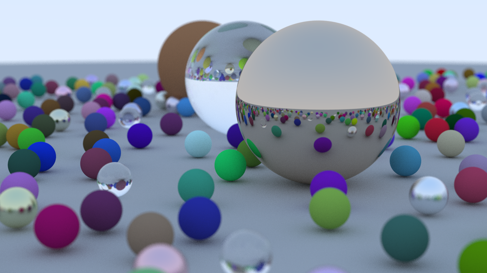

# RayTracing

## 1. 题目介绍

本题要求对一个采用朴素实现的光线追踪程序进行性能优化，在符合规则的前提下，尽可能缩短渲染时间。

程序通过逐像素采样和递归光线追踪生成图像，支持漫反射、金属和玻璃等材质，以及抗锯齿与景深效果。场景由灰色地面、随机材质的小球、三个大球和渐变天空组成，渲染结果以 PPM 格式保存。

## 2. 代码结构

项目使用 C++20 编写，通过 Makefile 构建。主要代码按功能组织如下：

| 路径 | 主要职责 |
|---|---|
| src/main.cpp | 解析命令行参数，构建固定场景，配置相机，控制计时和文件输出 |
| src/common.hpp | 定义公共常量、随机数状态及初始化规则，提供随机数和角度转换函数 |
| src/math/ | 提供三维向量运算、区间操作、颜色校正与输出 |
| src/geometry/ | 定义光线和命中记录，实现球体求交与场景物体的线性遍历 |
| src/material/ | 实现漫反射、金属和玻璃材质的光线散射 |
| src/render/ | 实现相机初始化、像素与镜头采样，以及递归光线追踪 |
| Makefile | 编译配置 |

## 3. 编译与运行

需要支持 C++20 的编译器和 Make。在项目根目录执行：

```bash
make -j     # 编译
make run    # 运行
make clean  # 清理
```

程序接受三个可选位置参数，不带参数时使用正式评测配置：

```bash
./build/RayTracing [width] [samples_per_pixel] [out.ppm]
```

| 参数 | 含义 | 默认值 |
|---|---|---|
| `width` | 图像宽度，高度按 16:9 计算且至少为 1 | 1200 |
| `samples_per_pixel` | 每像素采样数 | 200 |
| `output.ppm` | 输出文件路径 | 当前目录下的 `out.ppm` |

默认评测配置为 1200×675、200 spp、最大弹射深度 50。宽度和采样数必须是 `int` 范围内的正整数；参数错误、文件打开或写入失败时，程序返回非零退出码。

参考图片如下。默认情况下，你生成的图片与其完全一致。



输出采用纯文本 PPM（P3）格式，可用支持 PPM 的图像查看器打开，或安装 ImageMagick 后转换：

```bash
# ubuntu 24命令
sudo apt install imagemagick
convert out.ppm out.png
```

## 4. 优化规则

**不能修改**：
- `src/main.cpp`
- `src/common.hpp`
- `src/math/color.*`

**可以修改**：
- `src/geometry/`
- `src/material/`
- `src/render/`
- `src/math/` 中的其余文件
- `Makefile`

不得改变采样数、采样与散射分布、天空颜色、弹射深度及每个像素的随机数初始化和消耗顺序。不得缓存图片或提前计算像素。

## 5. 计时与评测

输出示例如下，我们关注其中的 `Render time`：
```text
Scene initialization time: 0.000104 s
Camera initialization time: 0.000023 s
Rendering 1200px wide, 200 spp, max depth 50 -> out.ppm
Done.
Render time: 1223.179 s
```

图像质量使用 `tools/check_psnr.py` 评估，脚本需要 Python 3.10 或更新版本。比较 PPM 的 8 位 RGB 值，按全部通道计算 MSE，使用 `PSNR = 10 * log10(255² / MSE)`，完全一致时为无穷大。参考标准输出为 `reference.ppm`，脚本默认阈值为 45 dB。你的优化需要通过该测试，输出**PASS**代表通过。

```bash
tools/check_psnr.py reference.ppm out.ppm
```

示例输出如下：
```bash
# PASS
Image: 1200 x 675
MSE: 0.000000; RMSE: 0.000000
Different channels: 0; maximum channel error: 0
PSNR: inf dB; threshold: 45 dB
PASS

# FAIL
Image: 1200 x 675
MSE: 2.920386; RMSE: 1.708914
Different channels: 367; maximum channel error: 254
PSNR: 43.476402 dB; threshold: 45 dB
FAIL
```

该朴素实现版本参考耗时为 **1223.179 s**，运行 CPU 为 `Intel(R) Xeon(R) Gold 5320 CPU @ 2.20GHz`。由于机器不同，会导致运行时间不同，该成绩仅供参考。

## 6. 其他

建议使用 Ubuntu 来完成该题目，不允许使用 Windows。编译器不建议使用 msvc。

使用虚拟机（例如 VMware ）或者 WSL 可能会有 CPU 性能损失，请注意。
